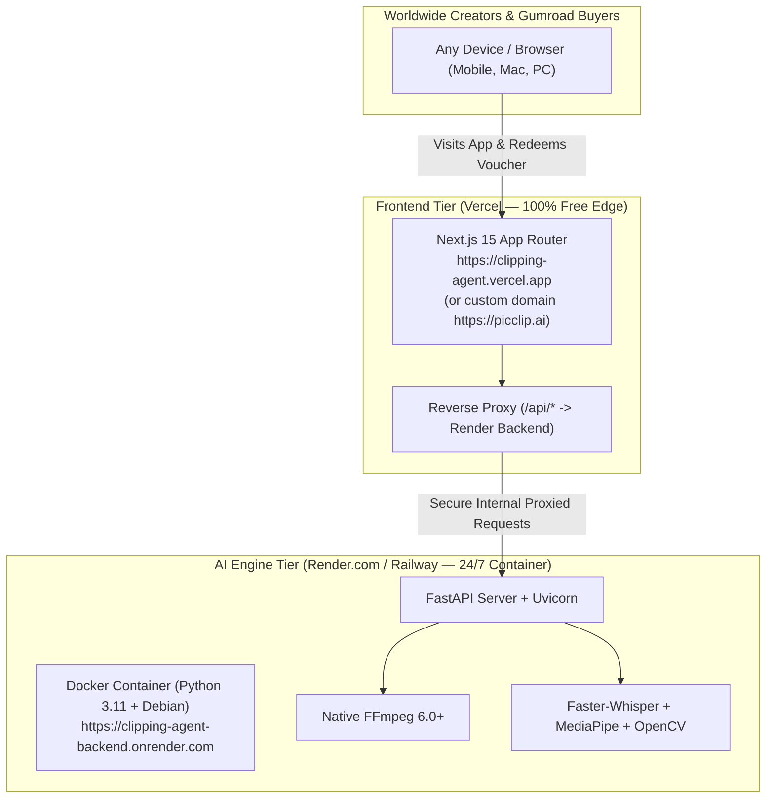

# ☁️ PicClip AI Studio — 24/7 Full Cloud Deployment Guide
### *Deploying Frontend on Vercel + AI ML Backend on Render / Railway*

---

## 🏗️ Architecture Overview



---

## 🚀 Step 1: Commit & Push to Your GitHub Repository

Your project is already linked to your GitHub repository: `https://github.com/Lihash2007/Clipping-Agent.git`.

Run the following commands in PowerShell/terminal:

```bash
git add .
git commit -m "feat: add cloud Dockerfile, render blueprint, and multi-content AI engine"
git push origin main
```

---

## ⚡ Step 2: Deploy AI Backend on Render.com (Free / 24/7)

**Render** automatically builds your Python backend using the newly added `backend/Dockerfile`.

1. Go to **[dashboard.render.com](https://dashboard.render.com)** and sign in with GitHub.
2. Click **New +** > **Web Service**.
3. Choose **"Build and deploy from a Git repository"** and select `Lihash2007/Clipping-Agent`.
4. Configure the service:
   - **Name**: `picclip-backend`
   - **Region**: Choose closest to you (e.g. *Singapore* or *Oregon* / *Frankfurt*).
   - **Branch**: `main`
   - **Root Directory**: `backend`
   - **Runtime**: Select **Docker** (Render will automatically detect `backend/Dockerfile`).
   - **Instance Type**: Select **Free** (or Starter $7/mo for faster CPU).
5. Click **Create Web Service**.
6. Wait 3–4 minutes for Docker to build. Once complete, Render will give you your live backend HTTPS URL:
   ```text
   https://picclip-backend.onrender.com
   ```
   *(Copy this URL — you will use it in Step 3!)*

---

## 🌐 Step 3: Deploy Frontend on Vercel (100% Free Global Edge)

**Vercel** hosts Next.js 15 with zero configuration and global CDN speeds.

1. Go to **[vercel.com](https://vercel.com)** and sign in with GitHub.
2. Click **Add New...** > **Project**.
3. Import `Lihash2007/Clipping-Agent`.
4. In the project setup screen:
   - **Framework Preset**: Next.js (automatically detected).
   - **Root Directory**: Click **Edit** and select the `frontend` folder!
5. Expand **Environment Variables** and add:
   - **Key**: `BACKEND_URL`
   - **Value**: Your Render URL from Step 2 (e.g. `https://picclip-backend.onrender.com`).
6. Click **Deploy**!
7. Within 60 seconds, Vercel gives you your live production URL:
   ```text
   https://clipping-agent.vercel.app
   ```
   *(Or your custom domain like `https://picclip.ai` under Project Settings > Domains).*

---

## 🔗 Step 4: Put Your Live URL into Gumroad

Now you have a real, permanent, 24/7 HTTPS web address!

In your Gumroad product setup:
1. Under **Content**:
   - Choose **"Redirect to an external URL"** and paste:
     ```text
     https://clipping-agent.vercel.app
     ```
     *(Or your custom domain `https://picclip.ai`)*
2. In the **Content / Delivery Note**, keep the instructions:
   > *"Thank you for purchasing PicClip!*  
   > *1. Copy your unique License Key below.*  
   > *2. Go to https://clipping-agent.vercel.app and click **Redeem Code**.*  
   > *3. Paste your key to instantly activate your Pro VIP Pass and Generation Credits!"*

---

## 🛠️ Alternative: Deploy Backend on Railway.app

If you prefer **Railway** instead of Render:
1. Go to **[railway.app](https://railway.app)** and click **New Project** > **Deploy from GitHub repo**.
2. Select `Lihash2007/Clipping-Agent`.
3. In service settings, set **Root Directory** to `/backend`.
4. Railway will automatically pick up `railway.json` and `backend/Dockerfile` and deploy it within 2 minutes.
5. Under Settings > Networking, click **Generate Domain** to get your public URL (e.g. `https://picclip-backend.up.railway.app`).

---

## 📋 Production Verification Checklist

- [x] `backend/Dockerfile` created with native FFmpeg, MediaPipe, OpenCV, Whisper, and FastAPI.
- [x] `backend/.dockerignore` configured to exclude large video caches and venv.
- [x] `render.yaml` and `railway.json` infrastructure blueprints added.
- [x] `frontend/next.config.ts` dynamically proxies `/api/*` to `process.env.BACKEND_URL`.
- [x] Rate limiting circuit breaker active on voucher redemptions.
- [x] Multi-content AI engine ready for Vlogs, Podcasts, Tutorials, Comedy & Gaming.