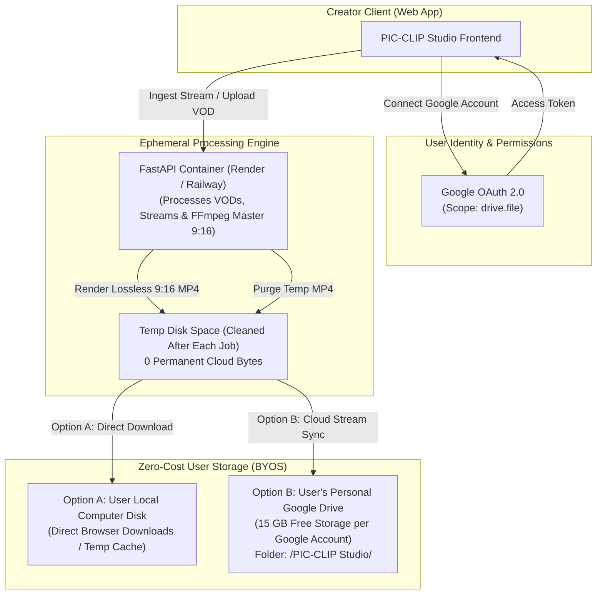
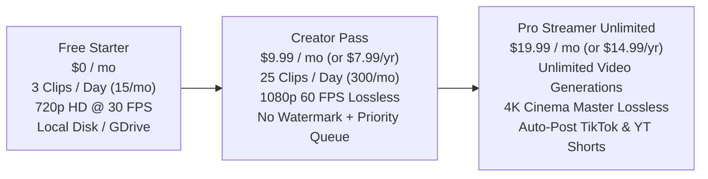

# PIC-CLIP AI Studio: Zero-Cost BYOS Hosting, Google Drive Integration & Monetization Blueprint

This document outlines the complete architectural draft to host, authenticate, scale, and monetize **PIC-CLIP AI Studio** with **\$0.00 cloud storage cost** by utilizing **User Local Disk** and **User Personal Google Drive (BYOS - Bring Your Own Storage)**, paired with a **3 Free Daily Generations Quota** and creator payment packages.

---

## 1. Zero-Cost Storage Architecture (BYOS)

Video storage and streaming bandwidth are typically the single largest expense for video SaaS platforms. PIC-CLIP eliminates this entirely by delegating storage directly to the creator:



### Why This Achieves \$0.00 Cloud Storage:
1. **Google gives 15 GB Free to Every User**: By storing raw stream VODs and finished rendered 9:16 clips inside the user's personal Google Drive folder (`/PIC-CLIP Studio/`), we pay **\$0.00** for storage.
2. **Zero Egress Bandwidth Fees**: When users watch, share, or download their clips from Google Drive or local disk, Google handles the CDN bandwidth at zero cost to us.
3. **Local Disk Option**: Users who prefer offline workflows save clips straight to their browser's local downloads.

---

## 2. Daily Free Generation Quota & Quota Logic

To prevent abuse while giving every user an irresistible taste of the AI clipping engine, the platform enforces a **Daily Free Generation Quota**:

* **Daily Free Allowance**: **3 video generations / renders free per day**.
* **Daily Reset**: Automatically resets at **00:00 UTC** every single day.
* **Monthly Free Cap**: **15 video generations / month** maximum on the free tier.
* **When Daily Limit is Reached (3/3)**:
  * The user is shown an elegant upgrade modal displaying:
    * Countdown timer until tomorrow's reset (e.g. *"Resets in 7h 24m"*).
    * Instant upgrade to **Creator Pass (\$9.99/mo)** for 25 generations/day.
    * 1-click **+50 Generation Top-up Pack (\$4.99)** that never expires.

---

## 3. Monetization & Payment Packages Matrix



### Detailed Package Comparison

| Feature | Free Starter (\$0/mo) | Creator Pass (\$9.99/mo) | Pro Streamer (\$19.99/mo) |
| :--- | :--- | :--- | :--- |
| **Target Audience** | Casual Gamers & Beginners | Daily Twitch, Kick & YT Streamers | Heavy Creators & Agencies |
| **Daily AI Generations** | **3 clips / day** | **25 clips / day** | **Unlimited generations** |
| **Monthly Quota** | 15 clips / month | 300 clips / month | Unlimited |
| **Storage Destination** | Local Disk / Google Drive | Local Disk / Auto Google Drive Sync | Google Drive + Cloud Backup |
| **Export Resolution & FPS** | 720p @ 30 FPS | **1080p @ 60 FPS** | **4K Ultra HD @ 60 FPS** |
| **Encoding Quality** | CRF 22 | **CRF 17 (Lossless Master)** | **CRF 15 (Cinema Master)** |
| **Watermark** | Subtle PIC-CLIP badge | **No Watermark** | **Custom Brand Watermark** |
| **Subtitle Styles** | 2 Styles (Clean, Bold) | **All 4 Styles + Neon Gold** | **All Styles + Custom Fonts** |
| **Auto-Publish Webhooks** | Manual download | Manual / Webhook ready | **Auto-post to TikTok, Shorts, Reels** |
| **Queue Priority** | Standard | **Priority Cloud Fast Lane** | **Dedicated GPU Lane** |

### Top-Up Add-on Pack:
* **+50 Video Generation Pack**: **\$4.99 one-time**
  * Perfect for users who hit their 3 daily clips during an epic stream session and want to render extra clips immediately without committing to a monthly subscription.
  * Credits never expire.

---

## 4. SaaS Unit Economics & Profit Margins

Because storage, bandwidth, and speech-to-text are offloaded to zero-cost/low-cost tiers:

| Cost Center | Provider | Our Cost Per User | Note |
| :--- | :--- | :--- | :--- |
| **Video Storage** | **User's Google Drive / Local Disk** | **\$0.00** | 100% offloaded to user |
| **Bandwidth Egress** | **Google Drive CDN / Local** | **\$0.00** | No AWS S3 egress bills |
| **Audio Transcription** | **Groq Cloud Whisper API** | **\$0.00** | 7,200 free audio mins/mo |
| **Virality Assessment** | **Google Gemini 1.5 Flash API** | **\$0.00** | 15 RPM, 1,500 requests/day free |
| **Frontend Hosting** | **Vercel / Cloudflare Pages** | **\$0.00** | Free tier handles 100GB+ traffic |
| **Database & Auth** | **Supabase** | **\$0.00** | 50,000 MAU free tier |
| **Core FFmpeg Compute** | **Render / Railway** | **\$0 – \$5.00 / mo** | Lightweight container for video slice |
| **Gross Profit Margin** | — | **~95% – 98%** | Almost every dollar from subscriptions is pure profit |

---

## 5. Google Drive Integration Specification

To link the user's personal Google Drive in production:

1. **Google Cloud Console Setup**:
   * Create an OAuth 2.0 Client ID at [console.cloud.google.com](https://console.cloud.google.com).
   * Authorized Redirect URI: `https://app.yourdomain.com/api/auth/callback/google`
   * Enabled Scopes:
     * `https://www.googleapis.com/auth/userinfo.email`
     * `https://www.googleapis.com/auth/drive.file` *(Allows app to create and manage only the files it generates in `/PIC-CLIP Studio/`, keeping user's private drive secure).*
2. **Upload Workflow**:
   * Backend generates the rendered 9:16 MP4 file.
   * Uploads file to user's Google Drive via `google-api-python-client` with parent folder ID.
   * Returns Google Drive web view and direct download link.
   * Immediately deletes temporary file from backend container.

---

## 6. Deployment Guide (One-Click Launch)

1. **Frontend**: Deploy to **Vercel** (`npm run build` -> Next.js edge deploy).
2. **Backend**: Deploy Docker container to **Railway** or **Render**:
   ```bash
   # Deploy using Dockerfile
   docker build -t pic-clip-backend .
   docker run -p 8000:8000 pic-clip-backend
   ```
3. **Environment Variables**:
   ```env
   GROQ_API_KEY=your_groq_whisper_key
   GEMINI_API_KEY=your_gemini_flash_key
   GOOGLE_CLIENT_ID=your_google_oauth_client_id
   GOOGLE_CLIENT_SECRET=your_google_oauth_secret
   NEXT_PUBLIC_API_URL=https://pic-clip-api.up.railway.app
   ```
