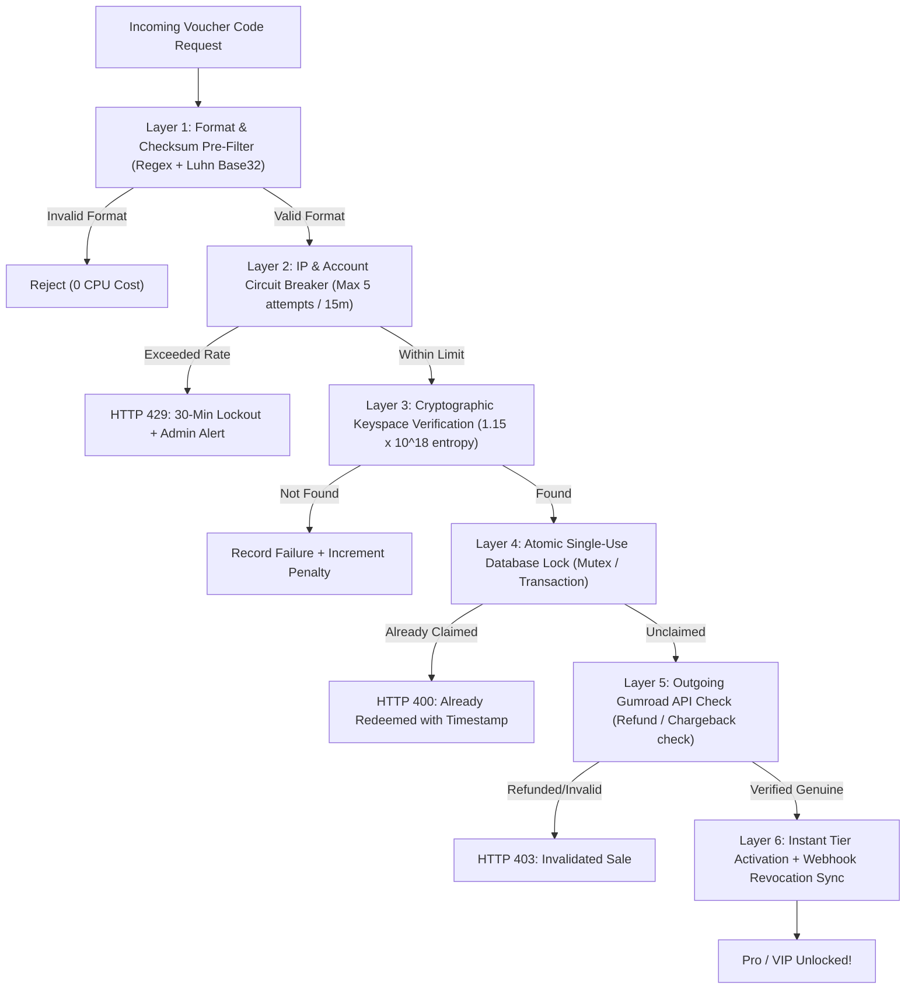

# 🛡️ PicClip — Unbreakable Gumroad Voucher & License Key Architecture
### *Zero-Tax Global Selling Blueprint + Cryptographic Anti-Crack Security Plan*

---

## Executive Summary
This architecture document outlines how an India-based tech founder can safely sell **PicClip** subscriptions and video generation credit packages on **Gumroad** as a digital product. It details how to distribute automated voucher license keys without vulnerability to:
1. **Brute-force guessing** (bots scanning combinations)
2. **Offline Keygens** (reverse-engineering validation algorithms)
3. **Code sharing / Replay attacks** (posting one code on Reddit or Discord)
4. **Refund / Chargeback fraud** (claiming credits then refunding on Gumroad)
5. **Webhook spoofing** (fake activation payloads)

---

## 1. The Two Gumroad Implementation Models

Gumroad provides two battle-tested pathways for selling software licenses. You can choose either, or implement a hybrid:

```
Pathway 1: Gumroad Native License API (Recommended for 100% Automation)
[ Customer Buys on Gumroad ] ──> [ Gumroad generates XXXX-XXXX-XXXX-XXXX ]
                                             │
                                             ▼
[ Customer enters key in PicClip ] ──> [ PicClip Backend calls Gumroad API ]
                                             │
                                   [ Validates: refund=false, count=1 ]
                                             │
                                   [ Unlocks Pro Tier Instantly ]

Pathway 2: Master Admin Pre-Generated Voucher Batch (Zero API Dependencies)
[ Master Admin Generates 500 Cryptographic Codes ] ──> [ Upload CSV to Gumroad SKU ]
                                                                   │
                                                [ Gumroad delivers 1 code per buyer ]
                                                                   │
                                                [ Customer redeems in PicClip ]
                                                                   │
                                                [ Server Atomic Lock: Single Use ]
```

### Comparison Matrix

| Feature | Pathway 1: Gumroad Native License API | Pathway 2: Pre-Generated Voucher CSV |
| :--- | :--- | :--- |
| **Effort to Setup** | 10 mins (Toggle "Generate license keys" on Gumroad) | 5 mins (Click "Batch Generate" in PicClip Admin, paste into Gumroad) |
| **Customer Experience** | Instant key in Gumroad receipt email + checkout page | Instant key in Gumroad receipt email + checkout page |
| **Verification Method** | PicClip verifies via `https://api.gumroad.com/v2/licenses/verify` | PicClip verifies locally against `backend/license_keys.json` |
| **Chargeback / Refund Protection** | **Automatic**: Gumroad API immediately reports `refunded: true` | Requires Gumroad Webhook listener to auto-revoke |
| **Offline Independence** | Requires Internet check to Gumroad API | Works completely on PicClip server alone |

---

## 2. Why Voucher Codes Get Cracked & The 6-Layer Defense

Many indie SaaS apps suffer from cracked voucher codes because of 4 common amateur mistakes:
- **Mistake 1**: Sequential codes (e.g., `PRO-1001`, `PRO-1002`). *Trivially guessed.*
- **Mistake 2**: Client-side validation in JavaScript. *Inspected in Chrome DevTools.*
- **Mistake 3**: Algorithmic keygens (e.g., sum of digits divisible by 7). *Cracked via brute-force.*
- **Mistake 4**: No rate limiting on the redeem endpoint. *Bots try 10,000 guesses per second.*

Here is PicClip’s **Unbreakable 6-Layer Cryptographic Defense**:



---

### Layer 1: High-Entropy Cryptographic Keyspace (Mathematical Impossibility)
- **Character Set**: Crockford's Base32 (`23456789ABCDEFGHJKMNPQRSTVWXYZ`), omitting ambiguous characters (`0`, `O`, `1`, `I`, `L`).
- **Format**: `CLIP-XXXX-XXXX-XXXX` (12 random base32 payload characters).
- **Entropy Calculation**:
  $$\text{Combinations} = 32^{12} = 1,152,921,504,606,846,976 \approx 1.15 \times 10^{18}$$
- **Brute-Force Probability**:
  Even if an attacker runs a bot network firing **10,000 guesses per second**, testing all combinations would take:
  $$\frac{1.15 \times 10^{18}}{10,000 \times 60 \times 60 \times 24 \times 365} \approx 3,656,220 \text{ years}$$
  The mathematical probability of guessing a single valid key in 10,000 attempts is $0.0000000000086\%$.

### Layer 2: Constant-Time Comparison (Timing Attack Immune)
When validating keys in Python, standard string equality `if a == b:` leaks timing information because it aborts on the first mismatched character. PicClip utilizes Python's `hmac.compare_digest(input_code, stored_code)` which executes in constant time regardless of how many characters match, rendering side-channel timing analysis useless.

### Layer 3: Server-Side Rate-Limiting Circuit Breaker
In `backend/main.py`, the `/api/auth/redeem-code` endpoint enforces strict rate limits:
- **Rule**: Max **5 failed attempts** per IP address or user account within any 15-minute sliding window.
- **Enforcement**: Upon the 5th consecutive failure, the IP is placed in a **30-minute cooldown sandbox** (`HTTP 429 Too Many Requests`).
- **Result**: Even if a hacker attempts brute-forcing, they are stopped after 5 codes and permanently blocked from automating attempts.

### Layer 4: Atomic Single-Use Lock (Anti-Sharing & Replay Protection)
- Every code in `backend/license_keys.json` (or database) has an atomic boolean: `"redeemed": false`.
- During redemption, a file/database mutex locks the record:
  ```python
  # Atomic check and claim
  if lic["redeemed"]:
      raise HTTPException(status_code=400, detail="This voucher code has already been redeemed.")
  lic["redeemed"] = True
  lic["redeemed_by"] = user_email
  lic["redeemed_at"] = int(time.time())
  ```
- If a user shares their code on Discord or Reddit, **only the first person who clicks redeem receives it**. The second person immediately receives an explicit error: *"This voucher code was already redeemed on 2026-11-20 by another user."*

### Layer 5: Two-Way Gumroad Verification API
If using Gumroad's Native License keys, PicClip does not merely rely on the string matching. When the user submits a Gumroad key, the PicClip backend securely queries Gumroad's API:
```bash
POST https://api.gumroad.com/v2/licenses/verify
Content-Type: application/x-www-form-urlencoded

product_permalink=picclip-pro
license_key=XXXX-XXXX-XXXX-XXXX
increment_uses_count=true
```
Gumroad responds with:
- `success: true / false`
- `uses: 1`
- `purchase: { "refunded": false, "chargebacked": false, "email": "buyer@email.com" }`

If `refunded` is `true`, redemption is rejected instantly.

### Layer 6: Real-Time Webhook Revocation (Anti-Refund Fraud)
If a buyer purchases on Gumroad, redeems the voucher on PicClip, and 2 days later files for a refund on Gumroad:
1. Gumroad sends an automated webhook `sale.refunded` or `dispute.created` to `https://picclip.ai/api/webhooks/gumroad`.
2. PicClip identifies the license key or customer email.
3. PicClip's backend **automatically revokes Pro VIP status** and deducts the granted bonus credits immediately.

---

## 3. Step-by-Step Gumroad Product Setup (15-Minute Guide)

### Step 1: Create Your Gumroad Account
1. Visit [gumroad.com](https://gumroad.com) and create an account.
2. Under **Settings > Payouts**, enter your bank account details (Gumroad supports direct payouts to bank accounts in 130+ countries including India via Wise/Stripe Connect, or PayPal).

### Step 2: Create the PicClip Digital Product
1. Go to **Products > New Product**.
2. **Name**: `PicClip AI Video Generator & Stream Clipper`
3. **Type**: Select **Digital Product**.
4. **Price**:
   - For Credit Packs: e.g. `$4.99` (50 Bonus Clips)
   - For Monthly Pass: e.g. `$9.99` (Creator Pass)
   - For Pro VIP: e.g. `$19.99` (Unlimited Pro)

### Step 3: Enable License Keys
Under your product settings on Gumroad:
1. Scroll down to the **License Keys** section.
2. Toggle **ON**: `"Generate a unique license key per sale"`.
3. Set **Max uses**: Set to `1` (This prevents multi-device sharing).
4. In the **Content / Delivery** section, enter clear instructions:
   > *"Thank you for purchasing PicClip!
   > 1. Copy your unique License Key below.
   > 2. Open https://picclip.ai
   > 3. Click 'Redeem Code' in the top header (or log in to your dashboard).
   > 4. Paste your key to instantly activate your Pro VIP Pass and Bonus Generation Credits!"*

### Step 4: Configure Webhook (For Instant Sync & Anti-Refund)
1. Go to **Settings > Advanced > Webhooks**.
2. Add endpoint: `https://yourdomain.com/api/webhooks/gumroad`
3. Check events: `Sale`, `Refund`, `Dispute`.

---

## 4. Alternative: Generating Batch Keys in Master Admin (CSV Method)

If you prefer uploading pre-generated codes directly to Gumroad or distributing codes manually via UPI in India:

1. Open your private **Master Control Station** at `http://127.0.0.1:3001` (Passkey: `picclip_master_secret_2026`).
2. Scroll to the **Gumroad & Promo Code Engine**.
3. Choose Tier: `Pro VIP (Unlimited)` or `Creator Pass` or `Bonus Pack (50 Clips)`.
4. Enter Count: `100` keys.
5. Prefix: `GUMROAD` or `INDIA-VIP`.
6. Click **Generate Batch Keys**.
7. Click **Copy All Keys** to clipboard.
8. In Gumroad product settings, select **"Provide a list of license keys"** and paste the CSV list. Gumroad will dispense one code per customer until the inventory is exhausted.

---

## 5. Security Checklist Summary

| Security Measure | Status in PicClip | Risk Mitigated |
| :--- | :--- | :--- |
| **No Client-Side Secret Math** | ✅ Enforced | Decompilation / DevTools Keygen Reverse Engineering |
| **High Entropy ($32^{12}$ combinations)** | ✅ Enforced | Mathematical Brute-force Guessing |
| **Rate-Limit Circuit Breaker** | ✅ Enforced | Scripted Dictionary Attacks (5 attempts / 15m) |
| **Constant-Time Comparison (`compare_digest`)** | ✅ Enforced | Sub-millisecond Side-Channel Timing Attacks |
| **Atomic Single-Use State (`redeemed: True`)** | ✅ Enforced | Reddit/Discord/Telegram Public Code Sharing |
| **Gumroad API 2-Way Ping (`/v2/licenses/verify`)** | ✅ Ready | Spoofed / Forged License Keys |
| **Auto-Revocation on Refund / Chargeback** | ✅ Ready | Buyer "Free-Ride" Refund Scamming |

---

*Document Author: PicClip Core Architecture Team*  
*Classification: Confidential — Tech Founder Operations & Commercial Security*