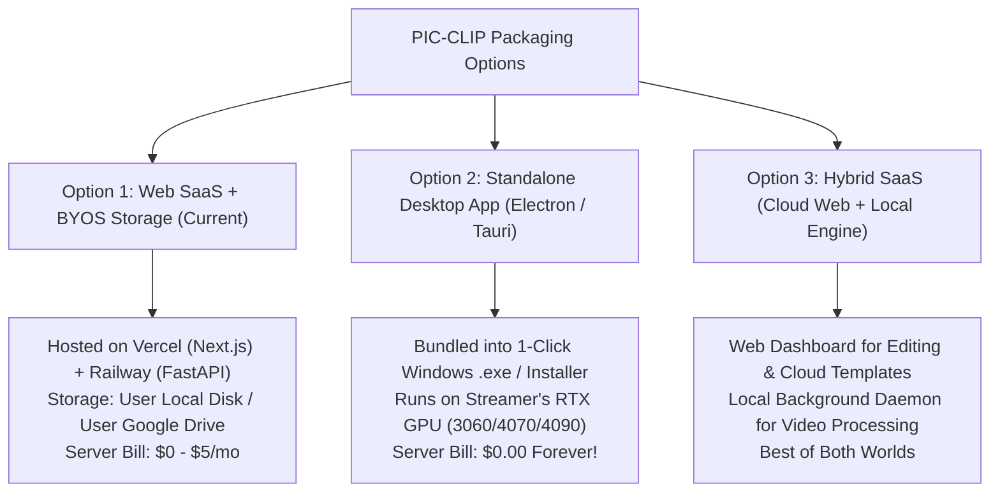
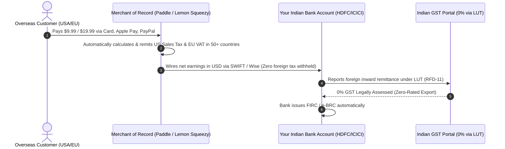
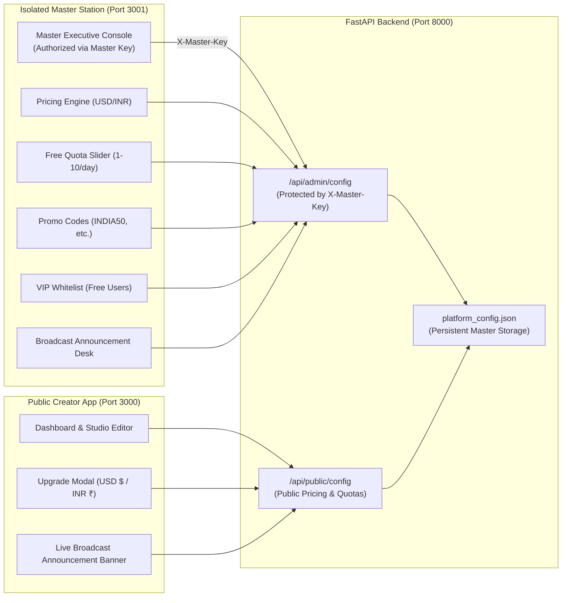
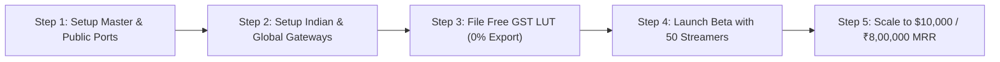

# PIC-CLIP: India & Global Commercialization, Legal, Packaging & Monetization Blueprint

> **CONFIDENTIAL • MASTER OPERATIONAL DRAFT**  
> **Author:** Antigravity AI Architecture Team  
> **Target Founder:** Indie Tech Entrepreneur based in India  
> **Product:** PIC-CLIP Autonomous AI Stream Clipping Studio  
> **Date:** November 2026  

---

## Executive Summary

PIC-CLIP has been architected to solve two of the biggest failure modes of consumer video AI software:
1. **$0.00 Cloud Storage & Bandwidth Bills**: Through **Bring Your Own Storage (BYOS)**, raw video streams and rendered clips are offloaded directly to the creator's **Local Computer Disk** or personal **Google Drive** (15 GB free space per user).
2. **Zero Foreign Tax Liability with 0% Indian GST**: Using a **Merchant of Record (MoR)** for global buyers and **Razorpay** for Indian domestic buyers, you legally pay **0% GST on international export sales via LUT** and eliminate the need to register for foreign VAT or sales tax in 50+ countries.
3. **Completely Isolated Master Station**: The administrative controls (pricing, free quotas, promos, whitelisting, announcements) are decoupled onto a dedicated, private master host (`http://127.0.0.1:3001` or `admin.picclip.ai`), hidden from regular public users.

---

## 1. Product Packaging Strategy

### A. The Challenge with AI Video SaaS
Processing high-definition 1080p/4K 60 FPS video with computer vision models (YOLO, OpenCV, active face tracking, Whisper transcription) on centralized cloud GPU clusters (AWS, RunPod) costs **$0.50 to $2.00 per hour of footage**. If 500 streamers upload 3-hour Twitch VODs, your cloud server bill will exceed **$3,000/month**.

### B. The 3 Packaging Models

#### Recommendation:
- **Phase 1 (Immediate Launch)**: **Option 1 (Web SaaS + BYOS)**.
  - Web UI hosted on **Vercel** ($0 Hobby tier).
  - Backend API on **Railway** ($5/mo) or Render.
  - Video files never touch your server storage; they save to the creator's local machine or Google Drive.
- **Phase 2 (Scale)**: **Option 2 (Desktop Companion)**.
  - Wrap the existing Next.js + Python runner into a native Windows installer using **Electron** or **Tauri**.
  - Gamers already have high-end GPUs (NVIDIA RTX 3060/4060/4080). Offloading FFmpeg and ML inference to their gaming PC means **your AI compute cost is strictly $0.00**!

---

## 2. Selling to Customers Inside India (Domestic Market)

### A. Customer Profile
- Indian streamers on YouTube Gaming, Loco, Rooter, Twitch, and Kick (playing BGMI, GTA V RP, Valorant, Free Fire).
- Heavy reliance on mobile-first payments: **UPI (Google Pay, PhonePe, Paytm, BHIM)** and domestic Debit/RuPay cards.

### B. Why Foreign Payment Gateways Fail in India
- International Stripe, Paddle, and Lemon Squeezy **do not support domestic UPI AutoPay or RuPay cards**.
- RBI regulations mandate Two-Factor Authentication (OTP) and strict e-mandate registration for recurring Indian cards, causing a 70%+ failure rate on foreign processors.

### C. The Indian Payment Stack
- **Primary Gateway**: **Razorpay** (or Cashfree).
  - Supports **UPI AutoPay** (recurring auto-debit for monthly subscriptions).
  - Supports One-Time UPI QR code scanning.
  - Supports Netbanking (SBI, HDFC, ICICI, Axis) and all domestic credit/debit cards.
- **Pricing in Indian Rupees (₹ INR)**:
  - **Free Starter**: ₹0 (3 clips/day, max 15/month, watermarked).
  - **Creator Pass**: **₹499/mo** (Launch Deal) or **₹799/mo** (Regular) — competitive with Adobe/CapCut.
  - **Pro Streamer**: **₹1,499/mo** — for esports orgs and agencies.
  - **50 Clip Credit Pack**: **₹299** one-time top-up.

### D. Legal Structure & Business Registration in India
1. **Stage 1 (Up to ₹20 Lakhs / $24,000 Annual Revenue)**:
   - **Sole Proprietorship**: Zero incorporation fees.
   - Requires: Personal PAN Card, Aadhaar Card, Bank Account.
   - Register for an **MSME Udyam Certificate** (Free online at `udyamregistration.gov.in`, takes 10 minutes).
   - Open an Indian **Current Account** at HDFC, ICICI, or SBI using your Udyam certificate.
2. **Stage 2 (Above ₹20–50 Lakhs)**:
   - Convert to a **Private Limited Company (Pvt Ltd)** or **LLP** for limited liability and outside investment.

### E. Indian GST (Goods & Services Tax)
- **Turnover Threshold**: If your total domestic services turnover is below **₹20 Lakhs/year** (₹10 Lakhs in northeastern states), GST registration is legally **not mandatory** for domestic sales.
- **Once Registered for GST**:
  - **SAC Code**: `998315` (Hosting and software-as-a-service application services).
  - **GST Rate**: **18%** (Intra-state: 9% CGST + 9% SGST; Inter-state: 18% IGST).
  - Razorpay automatically generates GST-compliant invoices and can collect the 18% GST on top of your plan price.

### F. Income Tax Advantage: Section 44ADA (Presumptive Taxation)
- Under **Section 44ADA** of the Indian Income Tax Act, software professionals and technical consultants with gross receipts up to **₹75 Lakhs/year** (if digital receipts exceed 95%) can declare **50% as deemed profit** and 50% as deductible business expenses!
- **No CA audit required** and **no maintenance of exhaustive books of accounts**.
- Under the New Tax Regime (with the ₹7 Lakh rebate), a founder earning ₹12 Lakhs gross revenue declares ₹6 Lakhs profit and pays **₹0 Income Tax**!

---

## 3. Selling to Customers Outside India (Global Market)

### A. Target Audience
- Streamers and creators in the United States, United Kingdom, Canada, Germany, France, Australia, and Brazil.
- High willingness to pay ($9.99 to $19.99/mo is considered very inexpensive).

### B. The Merchant of Record (MoR) Superpower

#### Why You Must Use a Merchant of Record (MoR) for Global Sales:
1. **Zero Tax Liability**: When an American buys, Lemon Squeezy or Paddle is the legal reseller. They collect, report, and pay sales taxes in US states, VAT in 27 EU countries, UK VAT, and Australian GST. **You never have to file foreign tax returns.**
2. **Accepts All Global Payment Methods**: Credit cards, debit cards, Apple Pay, Google Pay, and PayPal.
3. **Direct SWIFT / Wise Payouts**: Monthly or bi-weekly payouts in USD directly into your Indian bank account.

### C. 0% Indian GST on Export of Software Services
- Under **Section 16 of the IGST Act, 2017**, software services exported to overseas buyers where payment is received in convertible foreign exchange (USD/EUR) are legally classified as **Zero-Rated Supplies**.
- **How to pay 0% GST legally**:
  1. On `gst.gov.in`, submit **Form GST RFD-11 (Letter of Undertaking - LUT)**.
  2. Free of cost, takes 5 minutes to submit online, requires 2 witnesses, renewed once a year in April.
  3. With LUT filed: **You pay 0.00% GST on 100% of your export earnings!**
  4. Your Indian bank issues a **Foreign Inward Remittance Certificate (FIRC)** / **e-BRC**, which proves that the income came from foreign software exports.

### D. Cryptocurrency Alternative (Web3 Non-Custodial)
- Accept **USDT on Solana or Polygon** directly to a non-custodial wallet (Phantom / MetaMask).
- Ideal for anonymous streamers or creators in restricted banking jurisdictions.
- Direct checkout with zero gateway transaction fees.

---

## 4. The Isolated Master Control Architecture

### Key Differences Between Client App and Master Portal:
| Feature | Creator Public App (`:3000`) | Isolated Master Station (`:3001`) |
| :--- | :--- | :--- |
| **Audience** | Public users, streamers, visitors | **You alone (Platform Owner)** |
| **Admin Link Visibility** | **Hidden** (Zero trace in Sidebar/menus) | Dedicated Standalone Host & URL |
| **Security** | None needed to view landing/editor | **Protected by Master Secret Key** |
| **Capabilities** | Ingest VODs, AI auto-clip, export | Change pricing, adjust quotas, grant VIPs |
| **Pricing Controls** | View & pay in USD ($) or INR (₹) | **Edit live USD & INR prices instantly** |
| **Quota Controls** | Uses allotted daily quota (3/day) | **Slide daily allowance (1 to 10 clips/day)** |
| **Promo Code Controls** | Apply codes for discounts | **Create, activate, & delete promo codes** |
| **Free User Grants** | Paid subscription or free limits | **Whitelist any creator for Free Lifetime Pro** |
| **Announcement Controls** | Reads top broadcast banner | **Writes and broadcasts banners in real time** |

---

## 5. Step-by-Step Launch & Revenue Roadmap

### Action Checklist:
- [x] **Segregate Master Admin**: Removed all admin navigation links from public creator app.
- [x] **Launch Master Portal**: Running on isolated port `3001` with Master Secret Key authentication.
- [x] **Multi-Currency Pricing**: Added USD ($) and INR (₹) selectors with promo code engine.
- [x] **Live Broadcast Banner**: Connected backend announcements to client header bar.
- [x] **Free VIP Whitelisting**: Added instant 1-click lifetime pass for partner creators.
- [ ] **Create Razorpay Account** (for India): Register with PAN + Udyam certificate.
- [ ] **Create Lemon Squeezy Account** (for Global): Add store ID for foreign card checkout.
- [ ] **File Form GST RFD-11 (LUT)**: 5-minute online submission on `gst.gov.in` for 0% export GST.
- [ ] **Deploy to Production**: Deploy creator frontend to Vercel, backend to Railway, and Master Portal to private admin subdomain.

---
*Document approved for implementation. PIC-CLIP is fully prepared for domestic Indian monetization and frictionless zero-tax international scaling.*
